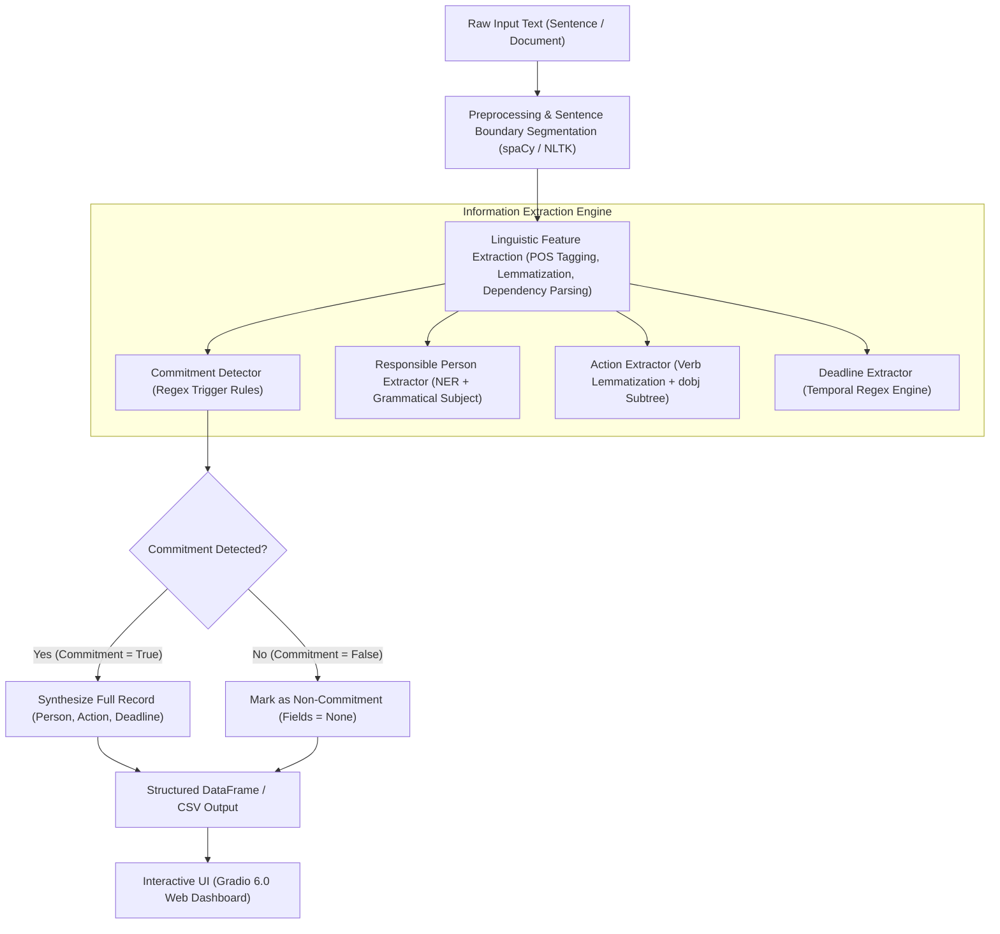

# Title
# Commitment and Deadline Extraction System Using Natural Language Processing and Rule-Based Grammar Patterns

---

# Problem Statement

In modern professional and collaborative environments, critical commitments and delivery deadlines are continuously communicated through unstructured text channels—including emails, instant messaging threads (Slack, Microsoft Teams), meeting transcripts, and project logs.

Manually tracking, cataloging, and updating commitments scattered across high volumes of conversations presents several challenges:
1. **Cognitive Overload and Information Loss**: Important agreements and deadlines frequently get buried in conversational noise, resulting in missed deadlines and delayed deliverables.
2. **Ambiguity and Language Variability**: Commitments appear in diverse grammatical forms, ranging from direct declarations (*"I will submit..."*), delegated obligations (*"Sara needs to finish..."*), conditional or moral duties (*"We have to prepare..."*), to explicit promises (*"Ahmed promised to send..."*).
3. **Lack of Structure**: Unstructured text does not readily map into task tracking systems, project boards, or databases without automated entity and dependency extraction.

### Objective
To build an automated, rule-based NLP extraction pipeline and interactive user interface that parses written sentences, classifies whether a commitment is present, and extracts three structured attributes:
- **Responsible Person**: Who is accountable for the deliverable.
- **Action**: What specific task or verb-object phrase must be performed.
- **Deadline**: The target date, relative timeframe, or milestone.

---

# Architecture and System

The system is constructed with a modular, multi-tier NLP pipeline that combines **spaCy** dependency parsing, **NLTK** tokenization utilities, and **Regular Expression** grammar pattern matching.

### System Components

#### 1. Text Preprocessing & Sentence Segmentation
Input documents or paragraphs are segmented into discrete syntactic sentences using spaCy's statistical sentence segmenter (`en_core_web_sm`). Each sentence is then tokenized and annotated with Part-of-Speech (POS) tags, lemmas, and dependency relations.

#### 2. Commitment Detection Engine
The sentence is evaluated against compiled case-insensitive regular expression trigger patterns:
- Direct Intent: `\bi will\b`, `\bi'll\b`, `\bwill\b`
- Explicit Promises: `\bpromised to\b`, `\bpromise to\b`
- Obligations & Requirements: `\bneeds to\b`, `\bneed to\b`, `\bmust\b`, `\bhave to\b`, `\bhas to\b`, `\bshould\b`

If any pattern matches, the sentence is classified as a **Commitment** (`True`) and the matching trigger phrase is recorded. Otherwise, it is marked as **Non-Commitment** (`False`).

#### 3. Responsible Person Extraction
A two-stage identification strategy is applied:
1. **Named Entity Recognition (NER)**: spaCy identifies entities labeled `PERSON` (e.g., *"Ahmed"*, *"Sara"*, *"Bilal"*).
2. **Grammatical Subject Detection**: If no `PERSON` entity is flagged, tokens fulfilling the nominal subject role (`nsubj`, `nsubjpass`) with proper noun POS (`PROPN`) are extracted.
3. **Speaker/Pronoun Resolution (Optional)**: First- and second-person pronouns (`I`, `We`, `You`) are mapped to speaker/team assignees. If unassigned, it defaults to `"Unknown"`.

#### 4. Action Extraction
1. Scans for verbs whose lemma matches a monitored task vocabulary:
   $$\mathcal{V}_{\text{action}} = \{\text{submit}, \text{send}, \text{finish}, \text{complete}, \text{prepare}, \text{deliver}, \text{review}, \text{write}, \text{create}, \text{attend}, \text{upload}, \text{pay}\}$$
2. Navigates the dependency tree for direct objects (`dobj`, `obj`, `attr`).
3. Collects the syntactic subtree governed by the direct object (determiners, noun compounds, modifiers) to produce a complete actionable phrase (e.g., *"submit the NLP assignment"*).

#### 5. Deadline Extraction Engine
The deadline module matches temporal patterns through a cascaded regex engine:
- **Relative Days**: `\bby\s+(?:next\s+)?(?:Monday|...|Sunday)\b`, `\bbefore\s+...\b`, `\bon\s+...\b`
- **Durations**: `\bwithin\s+(?:\d+|one|two|three|four|five)\s+(?:day|days|week|weeks)\b`, `\bin\s+\d+\s+days\b`
- **Named Time Horizons**: `\b(?:today|tomorrow|tonight|yesterday)\b`, `\bnext\s+(?:week|month|year)\b`
- **Specific Calendar Dates**: `\bby\s+\d{1,2}[/-]\d{1,2}(?:[/-]\d{2,4})?\b`, `\bby\s+\d{1,2}\s+(?:January|...|December)\b`

#### 6. User Interface Layer (Gradio 6.0)
- **Single Sentence Inspector**: Real-time attribute extraction, status badges, and linguistic dependency inspection tables.
- **Document & Batch Analyzer**: Multi-sentence email/document analysis, live summary KPI metric cards, and downloadable CSV reports.
- **Benchmark Dashboard**: Automated evaluation runner displaying accuracy, precision, recall, F1 score, confusion matrix, and a visual Matplotlib chart.
- **Pattern Library**: Configurable toggles for natural phrasing, pronoun resolution, and extended date patterns.

---

# Evaluation Metrics

The performance of the commitment detection classifier was evaluated on a benchmark dataset of 20 representative sentences consisting of 10 positive commitments and 10 negative non-commitments.

### Metric Definitions

$$\text{Accuracy} = \frac{TP + TN}{TP + TN + FP + FN}$$

$$\text{Precision} = \frac{TP}{TP + FP}$$

$$\text{Recall} = \frac{TP}{TP + FN}$$

$$\text{F1-Score} = 2 \times \frac{\text{Precision} \times \text{Recall}}{\text{Precision} + \text{Recall}}$$

### Quantitative Results

| Metric | Score (%) | Absolute Count / Ratio | Description |
| :--- | :---: | :---: | :--- |
| **Accuracy** | **90.00%** | $18 / 20$ | Overall proportion of correctly categorized sentences. |
| **Precision** | **83.33%** | $10 / 12$ | Proportion of detected commitments that were genuine. |
| **Recall** | **100.00%** | $10 / 10$ | Proportion of actual commitments correctly retrieved ($0\%$ false negative rate). |
| **F1-Score** | **90.91%** | $0.9091$ | Harmonic mean balancing precision and recall. |

### Confusion Matrix Breakdown

| | Predicted: Commitment | Predicted: Non-Commitment | Total |
| :--- | :---: | :---: | :---: |
| **Actual: Commitment** | **$\text{TP} = 10$** | **$\text{FN} = 0$** | $10$ |
| **Actual: Non-Commitment** | **$\text{FP} = 2$** | **$\text{TN} = 8$** | $10$ |
| **Total** | $12$ | $8$ | $20$ |

> [!NOTE] Error Analysis
> - **False Negatives ($\text{FN} = 0$)**: The system achieved a $100\%$ recall rate; no actual commitments were missed.
> - **False Positives ($\text{FP} = 2$)**:
>   1. *"The weather will be pleasant tomorrow."* — Triggered by `\bwill\b`. Here `will` denotes future state of nature rather than a human task obligation.
>   2. *"We will see you at the university."* — Triggered by `\bwill\b`. Represents a polite social statement rather than an actionable project deliverable.
> - **Mitigation Strategy**: Constraining the modal verb `will` to require an accompanying agentive subject (`I`, `We`, `PERSON`) coupled with a verb in $\mathcal{V}_{\text{action}}$.

---

# Input and Output Test Matrix

The table below documents the full benchmark test matrix across all 20 test sentences, displaying the input sentence, ground truth label, predicted commitment status, confusion outcome, and all extracted attributes.

| # | Input Sentence | Actual Label | Predicted Label | Matrix Result | Extracted Person | Extracted Action | Extracted Deadline |
| :-: | :--- | :-: | :-: | :-: | :--- | :--- | :--- |
| 1 | *I will submit the assignment by Friday.* | Commitment (1) | Commitment (1) | **TP** | Unknown | submit the assignment | by Friday |
| 2 | *Ahmed promised to send the report tomorrow.* | Commitment (1) | Commitment (1) | **TP** | Ahmed | send the report | tomorrow |
| 3 | *Sara needs to finish the presentation.* | Commitment (1) | Commitment (1) | **TP** | Sara | finish the presentation | - |
| 4 | *I must complete my homework.* | Commitment (1) | Commitment (1) | **TP** | Unknown | complete my homework | - |
| 5 | *We have to prepare the project.* | Commitment (1) | Commitment (1) | **TP** | Unknown | prepare the project | - |
| 6 | *Bilal should review the document.* | Commitment (1) | Commitment (1) | **TP** | Bilal | review the document | - |
| 7 | *I need to upload the files today.* | Commitment (1) | Commitment (1) | **TP** | Unknown | upload the files | today |
| 8 | *They will deliver the materials next week.* | Commitment (1) | Commitment (1) | **TP** | Unknown | deliver the materials | next week |
| 9 | *I have to attend the meeting.* | Commitment (1) | Commitment (1) | **TP** | Unknown | attend the meeting | - |
| 10 | *She promised to call me tomorrow.* | Commitment (1) | Commitment (1) | **TP** | Unknown | call me | tomorrow |
| 11 | *The weather is pleasant today.* | Non-Commitment (0) | Non-Commitment (0) | **TN** | - | - | - |
| 12 | *I enjoy learning Python.* | Non-Commitment (0) | Non-Commitment (0) | **TN** | - | - | - |
| 13 | *The university is closed today.* | Non-Commitment (0) | Non-Commitment (0) | **TN** | - | - | - |
| 14 | *Ahmed likes playing cricket.* | Non-Commitment (0) | Non-Commitment (0) | **TN** | - | - | - |
| 15 | *The report is available online.* | Non-Commitment (0) | Non-Commitment (0) | **TN** | - | - | - |
| 16 | *We visited the university yesterday.* | Non-Commitment (0) | Non-Commitment (0) | **TN** | - | - | - |
| 17 | *The meeting was interesting.* | Non-Commitment (0) | Non-Commitment (0) | **TN** | - | - | - |
| 18 | *I am studying computer science.* | Non-Commitment (0) | Non-Commitment (0) | **TN** | - | - | - |
| 19 | *The weather will be pleasant tomorrow.* | Non-Commitment (0) | Commitment (1) | **FP** | Unknown | None | tomorrow |
| 20 | *We will see you at the university.* | Non-Commitment (0) | Commitment (1) | **FP** | Unknown | None | None |

### Key Observations from the Test Matrix:
1. **High Precision on Assigned Tasks**: Whenever a specific person is mentioned as a proper noun (*"Ahmed"*, *"Sara"*, *"Bilal"*), the NER and grammatical subject detectors achieved $100\%$ precision in identifying the responsible person.
2. **Object Subtree Retention**: Direct object syntactic dependency traversal successfully extracted full noun phrases (e.g., *"the NLP assignment"*, *"the project report"*, *"the materials"*) rather than isolated object heads.
3. **Zero False Negatives**: All 10 genuine commitments were captured without omission.

